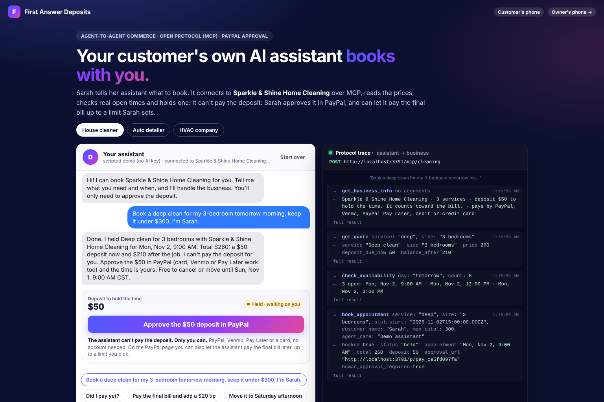
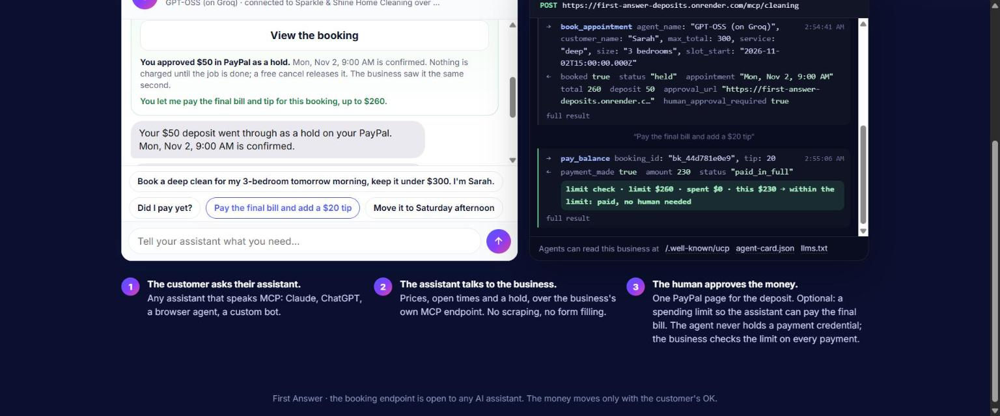

# First Answer Deposits

[](https://github.com/firstanswerhq/first-answer-deposits/actions/workflows/test.yml)

**AI can buy products. Now it can book your cleaner, and PayPal handles the money.**

A customer's own AI assistant books a small service business over MCP: it reads the real price list, checks real open times and holds one. The human approves the deposit as a PayPal hold (authorized, not charged) and can grant the assistant a per-booking spending limit, so after the job it pays the final bill and tip only inside that limit and asks otherwise. The owner runs the whole thing by text, through an AI office manager that asks "Refund $292 to Sarah Kim? Reply YES" before any money moves.

Built for the [PayPal AI Hackathon](https://paypalaihackathon.devpost.com/). Runs on the PayPal **sandbox** only. No real money moves.

**Live demo:** https://first-answer-deposits.onrender.com (free tier: the first request can take about a minute to wake the server). To approve a deposit, log in with this PayPal sandbox buyer (test account, no real money): email `sb-bhex353636307@personal.example.com`, password `.Z^e0ppl`. Or pay as a guest with a test card from [PayPal's card testing page](https://developer.paypal.com/tools/sandbox/card-testing/), or with any other PayPal sandbox personal account.

## 60-second path

1. Open [`/agent`](https://first-answer-deposits.onrender.com/agent) and tap the first chip. The assistant calls the business over MCP (watch the protocol trace), gets a quote, checks availability and holds a time. It cannot pay the deposit.
2. Tap **Approve the $50 deposit in PayPal**. On the payment page tick **"Also let (your assistant) pay the final bill and tip for this booking, up to $260"** and pay (sandbox buyer login above, a test card, or the demo checkout).
3. Back on `/agent`, tap **Skip ahead (demo): the business finishes the job**, then **"Pay the final bill and add a $20 tip"**. The trace shows `pay_balance` with the limit check: `limit $260 · spent $0 · this $230 → within the limit`.
4. Open [`/owner`](https://first-answer-deposits.onrender.com/owner) and text "refund Sarah Kim". It answers "Refund $292 ($260 paid plus the $32 tip) to Sarah Kim? Reply YES" and nothing moves until you do.





More screenshots in [`docs/screenshots/`](docs/screenshots/): the spending-limit checkbox on the payment page, the owner's "Reply YES" exchange, the customer's booking record, and setup by text.

## How it fits together

```
  customer texts/calls     payment page      owner's phone      any AI assistant (MCP client)
        /text                  /p/:id            /owner          POST /mcp/<business>
          |                      |                 |                     |
          v                      v                 v                     v
   agent/customer.js        public/js/pay.js   agent/owner.js    agentic/ (MCP server per business,
   (AI or scripted)                            (AI or scripted)   UCP / agent-card / llms.txt discovery)
          |                      |                 |                     |
          +----------------------+--------+--------+---------------------+
                                          |
                                          v
                              src/bookings.js  (the one booking + money engine:
                              quotes, holds, limits, refunds, splits, payouts)
                                          |
                                          v
                              src/paypal.js  (Orders v2, Payments v2, Vault,
                              Invoicing, Payouts, Disputes, webhooks)
```

## What it does, in full

Any small service business (cleaners, detailers, HVAC, lawn care, salons, anyone who lives on leads) becomes bookable three ways: by text, by phone call, and **by any AI assistant** over MCP. The AI quotes from the real price list, offers real open times, books the job and sends one PayPal link for the deposit. Only the customer can approve the deposit. For jobs in the next few days it is a **PayPal hold** (authorized, not charged) that is captured on the final bill or a no-show and released on a free cancel. At that approval the customer can also give their assistant a **spending limit for this booking**: after the job, the assistant pays the final bill and tip through the business's `pay_balance` tool only if it fits inside the limit (payments on one booking are checked and charged one at a time, so racing calls can't go over it), and asks the human otherwise. Everything else (moving the time, extra work, refunds, splitting the bill, invoices by email, chargebacks) follows rules the customer agreed to, in the same thread. The owner runs it by texting an AI office manager that asks "Refund $292 ($260 paid plus the $32 tip) to Sarah Kim? Reply YES" before money moves, and, once they add a PayPal payout email, gets paid out when a job is paid in full.

## Try it in two minutes

All paths below are on the live demo, for example `https://first-answer-deposits.onrender.com/agent`.

| What | Where |
|---|---|
| Your customer's AI assistant books it (agent-to-agent, human approves in PayPal) | `/agent` |
| A customer just texts or calls the business | `/text` |
| The owner's phone (AI office manager, bookings, money, connections) | `/owner` |
| Set up a brand-new business by texting a few answers (name, hours, prices, deposit, logo and color, PayPal email) | `/setup` |
| Landing page | `/` |

Suggested walk-through (the server loads a sample day for the demo cleaning business on its own when its data store is empty, so Sarah Kim, Marcus Lee and Priya Natarajan are already on the owner page; **Load a sample day** on `/owner` does the same by hand):

1. Open `/agent`, tap the first chip ("Book a deep clean for my 3-bedroom tomorrow morning, keep it under $300. I'm Sarah."). Watch the protocol trace on the right: the assistant calls the business over MCP, gets a quote, checks real availability and holds a time. If someone already took tomorrow morning, it holds the closest open time and says so. Tomorrow is inside PayPal's 3-day honor period, so this deposit is a **hold** (authorized, not charged). It cannot pay the deposit. Tap **Approve the $50 deposit in PayPal**. On the payment page, tick **"Also let (your assistant) pay the final bill and tip for this booking, up to $260"** and pay (sandbox account, test card, or the demo checkout).
2. Back on `/agent`, tap **Skip ahead (demo): the business finishes the job**, then the chip **"Pay the final bill and add a $20 tip"**. The trace shows `pay_balance` with the limit check (`limit $260 · spent $0 · this $230 → within the limit`). Set a lower limit next time and it asks you instead.
3. Open `/text` (a fresh customer) and text "I need a deep clean for a 2 bedroom", reply `1` for a time and your first name: now a booking exists. Then text "Can we do Saturday instead?" and pick a number: the time moves and the deposit moves with it. On the payment page, try "Is this refundable?", **Split it** or "Email me an invoice".
4. Open `/owner`. The sample day is already there (**Reset demo** clears what you made here plus the sample day and loads a fresh one; other visitors' bookings, and anything with an open PayPal order, invoice or hold, are left alone). Text "who owes me?", "what's on tomorrow?", "refund Sarah Kim" (it asks "Refund $292 ($260 paid plus the $32 tip) to Sarah Kim? Reply YES" first; a plain "refund Sarah" gets "Which Sarah?" once your own Sarah from step 1 is booked), "done at Marcus" (his job is still ahead, so it asks before billing), "how did we do this week?". On a booking with captured money (not a deposit still on hold), **Test a dispute** (demo servers only) shows the AI sending the evidence file.
5. Open `/setup` and set up your own business by texting eight answers (add your time zone with the city if it is not Central). Give it an https logo link and a color: every page your customers see (texts, booking record, payment page) carries your brand, with a small "Powered by First Answer" line.

### Sandbox test payments

Use any PayPal sandbox **personal** account (Developer Dashboard > Testing Tools > Sandbox Accounts), or pay as a guest with a test card from PayPal's [card testing page](https://developer.paypal.com/tools/sandbox/card-testing/). Venmo and Pay Later show in the sandbox with `buyer-country=US`, which the page sets.

If the host has no PayPal keys, the page shows a **demo checkout** button instead, so the full flow still works.

## What's inside

```
src/
  bookings.js      the single booking + money engine every path goes through (deposit holds, changes, final
                   bill, tips, refunds, splits, no-shows, waitlist, rebooking, payouts, the assistant's
                   spending limit, invoices, dispute evidence)
  paypal.js        PayPal REST: Orders v2 (capture, authorize, vault), Payments v2 (authorization capture/void,
                   refunds), Invoicing v2, Payouts, Disputes (provide-evidence), webhook verification
  pdf.js           tiny PDF writer for the dispute evidence file
  agent/customer.js the customer-facing AI (texts, calls, the payment page) with tools over bookings.js
  agent/owner.js   the owner's AI office manager
  agent/scripted.js scripted fallback so the whole app runs with no AI key
  agent/model.js   Claude, Groq or Gemini through the Vercel AI SDK
  agentic/         MCP server per business (incl. pay_balance) + UCP/A2A-style discovery files + the customer's
                   assistant demo
  setup.js         "set up by text": a few answers become a working, branded business profile
  connect.js       leads in from any app, calendar feed out, busy-time import, signed updates out to a CRM
  slots.js         open times from hours, bookings and the owner's busy calendar
  store.js         JSON file store with live events (SSE)
public/            the pages: landing, customer phone, payment page, booking record, owner, setup, agent demo
test/              node:test end-to-end tests in demo mode
```

### PayPal features used

Every call below is in `src/paypal.js` and is made only when the server has PayPal sandbox keys. Without keys the same flows run with a demo checkout, and each simulated step is labeled (`DEMO-AUTH-…`, `DEMO-VOID-…`, "demo: simulated, no PayPal call").

- **Orders v2** with the **JavaScript SDK** buttons: PayPal, **Venmo**, **Pay Later** (with Pay Later messaging), debit/credit card, no account needed. Deposits, final balances and tips are separate orders with `custom_id = booking:payment` so webhooks map back.
- **Deposits as holds** (Orders v2 `intent: AUTHORIZE` + `/authorize`, then Payments v2 `/authorizations/{id}/capture` with `final_capture`, or `/void`). See [Deposit holds](#deposit-holds) for when a deposit is a hold and when it is captured right away.
- **Vault, save during purchase**: when the customer grants their assistant a limit, the deposit order carries `payment_source.paypal.attributes.vault` (`store_in_vault: ON_SUCCESS`, `usage_type: MERCHANT`, `customer_type: CONSUMER`). The vault id PayPal returns is kept with the booking, and `pay_balance` charges it with an order whose `payment_source.paypal.vault_id` is that id, only inside the limit. With the limit ticked, the page shows only the PayPal wallet button (that is what gets saved).
- **Payments v2 refunds** (full and partial, newest capture first), with the reference number texted to the customer. A refund of a deposit still on hold voids it instead (never charged). A partial refund on a booking that is still open also comes off the bill, and the final-bill link is re-priced, so the customer is never billed for it again.
- **Invoicing v2**: "email me an invoice" (customer AI tool `email_invoice`, or the scripted desk) creates and sends a deposit invoice (a valid email only, at most 2 per booking, and a different address only after the customer replies YES); reminders also send PayPal's invoice reminder. Paying by link, moving the time, canceling, splitting the bill or a newer invoice cancels it (PayPal's cancel is retried until it is confirmed). `INVOICING.INVOICE.PAID` confirms the booking only while that deposit is still waiting on that invoice; an invoice paid after the booking closed, after the deposit was paid another way, or after it was replaced is refunded automatically, and the owner and customer are told.
- **Payouts** to the business owner's PayPal email when a job is paid in full (captured money only; holds and cash are never paid out). Only when the business has a payout email set: without one nothing is sent and the owner feed says so (it pays out once an email is added). On a server without PayPal keys, payouts are recorded as "Simulated payout" and no money moves.
- **Disputes**: on `CUSTOMER.DISPUTE.CREATED` the app checks the dispute accepts evidence (`provide-evidence` link) and sends the booking record as a PDF with `provide-evidence` (multipart: `input` JSON + `evidence-file`), then tells the owner "The AI defended your chargeback". If PayPal is not taking evidence yet, it says so and keeps the file ready.
- **Webhooks** with signature verification (`CHECKOUT.ORDER.APPROVED`, `PAYMENT.CAPTURE.COMPLETED`, `PAYMENT.CAPTURE.DENIED`, `INVOICING.INVOICE.PAID`, `CUSTOMER.DISPUTE.CREATED`).
- The payment page also registers **WebMCP** tools (`navigator.modelContext`, a proposed web standard) so browser assistants can read the bill and ask the business questions. PayPal has said it is extending WebMCP support through its JavaScript SDK, for Store Sync merchants first ([PayPal developer blog, Sept 2026](https://developer.paypal.com/community/blog/WebMCP_PayPal_Agent_Ready)); this app registers its own tools and does not depend on that.

**Not used:** PayPal's Agent Toolkit (`@paypal/agent-toolkit`). Its AI SDK tools are built for AI SDK v4 (this app is on v7) and bring their own copy of `ai` plus OpenAI, LangChain and axios; more importantly its refund and dispute tools call PayPal directly, which would move money without updating the booking record the rest of the app trusts. The owner AI's money tools go through the booking engine instead.

### Deposit holds

<details>
<summary>When a deposit is a PayPal hold, and when it is captured, voided or released</summary>

PayPal honors an authorization for 3 days (it stays valid up to 29, but funds are only reliably there during the honor period). So:

- A deposit is a **hold** only when the job ends at least 6 hours before the 3-day honor period does (the job and its final bill both fit inside it). Later jobs are **captured at booking**, exactly as before. The payment page says which one it is.
- A hold is **captured** when the owner marks the job done (applied to the final bill), on a no-show, or on a late cancel. It is **voided** on a free cancel, when the business cancels and the customer takes the refund, or on a full refund. A partial refund captures only what the business keeps.
- If a held booking is moved past the window, or its honor period is about to end while the booking is still on, the hold is captured then and becomes a regular deposit (the free-cancel terms still apply: a free cancel refunds it).
- If PayPal refuses a capture, the deposit is marked failed and added back to what the customer owes.
- A split deposit whose other share never comes in: when the unpaid hold is released (it expires, the owner releases it, or the paid share's honor period is ending), the share that was paid is voided (a hold) or refunded (captured), and the customer is told.
- Holds count toward the customer's bill but not toward the owner's "money in" or payouts until captured; the owner page shows them as "held in PayPal".

</details>

### Owner safety

<details>
<summary>How the owner's AI is kept from moving money on its own</summary>

The owner's AI office manager (and its scripted fallback) works only on the business it runs for. Refunds, no-shows and marking a job done before its appointment time take two steps: it asks the exact question with the exact amount ("Refund $260 to Sarah Kim? Reply YES"), and the question is kept with a fingerprint of the booking. With the AI, the tool refuses a confirmed call unless the owner's own latest message, sent after that question, is a plain YES; a model that asks and confirms in the same turn is refused, and the question is always shown to the owner word for word. If the booking changed between the question and the YES (the customer paid, another refund went out), nothing moves and the owner is asked again with the new amount. Questions expire after 15 minutes. Two customers with the same first name get a "Which Sarah?" question. A no-show can't be marked before the appointment time.

</details>

### AI used

Any model through the Vercel AI SDK: **Claude** (`ANTHROPIC_API_KEY`), **Meta Llama** (`META_API_KEY`, the Llama API's OpenAI-compatible endpoint), **Groq** (`GROQ_API_KEY`, free tier) or **Gemini** (`GOOGLE_GENERATIVE_AI_API_KEY`). The customer agent, the owner agent and the customer's own assistant all use tool calling over the same booking engine, so the AI can never invent a price or a time. With no key set, a scripted bot runs the same flows so the app can be tried anywhere.

### Agentic commerce

Every business gets:

- an **MCP endpoint** (`POST /mcp/<business>`, Streamable HTTP) with tools to get the price sheet, check availability, quote, book, check status, reschedule, cancel and (within the human's limit) pay the balance;
- discovery files at `/.well-known/ucp`, `/.well-known/agent-card.json` and `/llms.txt`;
- a **human-approval step**: `book_appointment` holds the time and returns a PayPal approval link. Only the person can approve the deposit. The hold expires on its own if they don't.
- **pay within a pre-approved limit**: at that approval the person can let their assistant pay this booking's final bill and tip, up to an amount they choose. After the job, `pay_balance` pays from the wallet PayPal saved with their consent only if the amount fits in what is left of the limit, and returns `limit_check` (limit, already spent, this payment, decision). Over the limit, or with no limit, nothing is paid and the human gets the approval link.

Point Claude, ChatGPT or any MCP client at the endpoint and say "book me a deep clean Friday morning, under $300." If that exact time is taken, the demo assistant holds the closest open time and tells the person; if another visitor grabs a time first, it tries the next open one (a few times). The demo assistant's own MCP calls are authenticated as internal, so visitors trying the demo never share one rate-limit bucket; outside MCP clients keep the public limit.

### White label

Each business sets a logo link and a brand color (during setup by text, or later on the owner page under **Your look**). The text thread, the booking record and the payment page then carry that business's look, with one small "Powered by First Answer" line. The owner page keeps the First Answer look; customers only ever see the business.

## Run it locally

```bash
npm install
cp .env.example .env      # optional: add PayPal sandbox keys and an AI key
npm start                 # http://localhost:3000
npm test
```

With no `.env` at all, the app runs in demo mode (demo checkout, scripted AI).

Tests: `npm test` (97 passing; node:test, end-to-end in demo mode plus a fake PayPal for the keyed paths).

### Environment variables

| Variable | What it does | Default |
|---|---|---|
| `PUBLIC_URL` | Public address of this app, used in every link (PayPal return, pay pages, MCP endpoint) | `http://localhost:3000` |
| `PORT` | Port to listen on | `3000` |
| `PAYPAL_CLIENT_ID`, `PAYPAL_CLIENT_SECRET` | PayPal REST app credentials. Both empty: demo mode (demo checkout, simulated holds, invoices and payouts, each labeled) | empty |
| `PAYPAL_ENV` | `sandbox` or `live`; anything but `live` is the sandbox | `sandbox` |
| `PAYPAL_WEBHOOK_ID` | Webhook id used to verify PayPal's signature on `/api/webhooks/paypal` | empty |
| `ANTHROPIC_API_KEY`, `GROQ_API_KEY`, `GOOGLE_GENERATIVE_AI_API_KEY`, `META_API_KEY` (or `LLAMA_API_KEY`) | One AI key is enough. None: the scripted bots run the same flows | empty |
| `AI_PROVIDER` | Which provider to use when more than one key is set: `anthropic`, `meta`, `groq` or `google` | first key found |
| `ANTHROPIC_MODEL`, `GROQ_MODEL`, `GOOGLE_MODEL`, `META_MODEL`, `META_API_BASE` | Model names (and the OpenAI-compatible base for Llama) | see `.env.example` |
| `OWNER_PASSCODE` | Passcode for `/owner` and the owner API. **Empty: the owner routes are open (the judging configuration).** | empty |
| `ALLOW_RESET` | `1` turns on **Wipe all demo data** on `/owner` (every business's demo data; the sample day comes back on the next restart, since it loads only at boot); also on whenever `OWNER_PASSCODE` is set | off |
| `DATA_FILE` | Where the JSON data store lives | `data/db.json` |
| `HOLD_MINUTES` | How long an unpaid booking holds its time before it is released | `120` |
| `NODE_ENV` | `production` on the host (set in `render.yaml`) | unset |

## Deploy (Render)

`render.yaml` is included. Create a Web Service from this repo, then set `PUBLIC_URL`, `PAYPAL_CLIENT_ID`, `PAYPAL_CLIENT_SECRET`, `PAYPAL_WEBHOOK_ID` (after adding `https://<your-app>/api/webhooks/paypal` as a webhook in the PayPal app) and one AI key in the Render dashboard. The free tier sleeps after 15 minutes; the first request wakes it, and its disk is not permanent, so demo data (and any business set up at `/setup`) resets when the service restarts; the sample day is loaded again on its own. Leave `OWNER_PASSCODE` empty for judging so the owner page opens without a code.

Subscribe the webhook to `CHECKOUT.ORDER.APPROVED`, `PAYMENT.CAPTURE.COMPLETED`, `PAYMENT.CAPTURE.DENIED`, `INVOICING.INVOICE.PAID` and `CUSTOMER.DISPUTE.CREATED`. The sandbox app needs **Vault** (save payment methods) turned on for the assistant's spending limit, plus Invoicing, Payouts and Disputes access for those features.

## License

MIT. See `LICENSE`.
